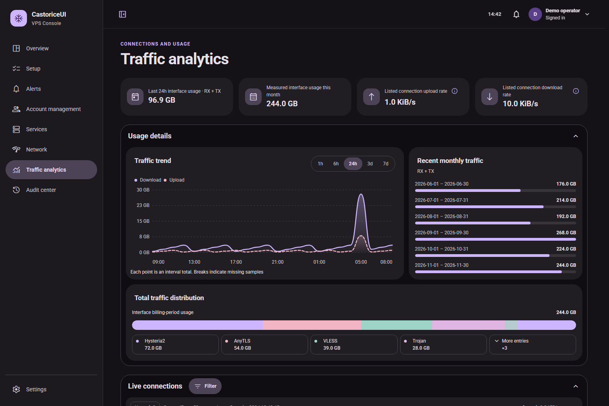

# CastoriceUI


CastoriceUI 是面向 Linux VPS 的 Material Design 3 运维面板，可在同一个界面查看主机资源、网卡流量、代理连接、网络质量、服务状态和审计记录。前端使用 React，后端使用 Python 和 SQLite。

[最新版下载](https://github.com/Kokomi-maomeng/Material-Design-CastoriceUI/releases/latest) · [部署指南](docs/DEPLOYMENT.md#choose-the-route) · [支持矩阵](docs/SUPPORT_MATRIX.md) · [English](#english)



*流量分析界面，使用合成示例数据。*

## 面板能做什么

| 模块 | 能查看或操作的内容 |
| --- | --- |
| 主机和服务 | CPU、内存、存储、负载与运行时间，服务状态及资源采样曲线 |
| 流量分析 | 1 小时至 7 天的趋势、月度用量、总流量分布，以及带地址精确匹配的实时连接筛选 |
| 账号和订阅 | 账号状态、已映射的累计用量和关联订阅。未匹配账号的 Hysteria2 累计量单独列出 |
| 网络质量和记录 | IPv4/IPv6 探测、告警确认、审计搜索与保留天数设置 |
| 界面和首次使用 | 中英文与跟随系统、浅色和深色、键盘操作、减少动态效果，以及可在刷新后续接的首次初始化 |

流量分布分别标注网卡账期用量和协议核心累计值。有可计算的未归属差额时，图中会单独列出。历史图从安装后的真实采样开始。

## 部署与接入

1. 从 [GitHub Releases](https://github.com/Kokomi-maomeng/Material-Design-CastoriceUI/releases/latest) 下载同一版本的安装包与 `SHA256SUMS.txt`，用 `sha256sum -c SHA256SUMS.txt` 核对后解包。
2. 按 [部署指南](docs/DEPLOYMENT.md#choose-the-route) 选择全新安装、接入已有代理主机或升级。生产部署使用 systemd、Nginx 和有效 TLS，面板后端与协议管理接口监听本机回环地址。
3. 首次使用时，在服务器生成一次性引导码，再从 HTTPS 面板创建管理员。保存节点名称和流量额度后即可进入总览，也可以继续接入已有数据源。升级时使用部署指南中的事务安装流程和回退点。

| 数据源 | 支持的协议或数据 |
| --- | --- |
| Hysteria2 Traffic Stats API | 累计流量、在线计数和活动流 |
| sing-box Clash API | 通过明确的入站标签映射接入 AnyTLS、VLESS（含 XTLS Vision / Reality）、SOCKS5、Shadowsocks、VMess、Trojan 和 TUIC |

代理核心、API 密钥、账号映射、订阅和探测目标的准备步骤见 [数据接入](docs/INTEGRATION.md)。功能与受测环境见 [支持矩阵](docs/SUPPORT_MATRIX.md)。

## 本地开发

需要 Python 3.11+，以及 Node.js `^20.19.0 || ^22.12.0 || >=24.0.0`。

```bash
git clone https://github.com/Kokomi-maomeng/Material-Design-CastoriceUI.git
cd Material-Design-CastoriceUI
npm ci
npm run doctor
python3 -m venv ../.castoriceui-venv
node scripts/python-run.mjs -m pip install -r server/requirements.txt
npm run check
npm run dev
```

Debian 源码环境先安装 `python3-venv`。Windows PowerShell 用 `python -m venv ../.castoriceui-venv` 创建同一项目环境。开发服务器在 `https://127.0.0.1:5173` 提供前端，并将 `/api/` 转发到本机回环后端。Linux/WSL 后端与 SSH 本地端口转发的用法见 [贡献指南](CONTRIBUTING.md)。

## 文档

- [v6.6.2 发布说明](docs/RELEASE_NOTES_v6.6.2.md)
- [部署与回退](docs/DEPLOYMENT.md) · [API 与数据源](docs/INTEGRATION.md) · [监控指标](docs/MONITORING.md)
- [登录背景与液态玻璃](docs/V5.3_BACKGROUND.md) · [浏览器支持](docs/BROWSER_SUPPORT.md)
- [贡献指南](CONTRIBUTING.md) · [安全策略](SECURITY.md) · [MIT 许可证](LICENSE)

## English

CastoriceUI is a Material Design 3 dashboard for monitoring Linux VPS hosts. It brings together host resources, interface traffic, live proxy connections, IPv4/IPv6 network quality, services, subscriptions, alerts, and audits. The interface supports English and Chinese, system language selection, keyboard navigation, and reduced motion.

Use the traffic page to compare interface billing-period usage with protocol counters, inspect trends and monthly totals, and filter live connections. The panel reads Hysteria2 Traffic Stats and sing-box Clash API data through loopback endpoints. Account traffic and subscriptions use mappings in the protected server configuration.

Download the archive and matching SHA-256 manifest from the [latest release](https://github.com/Kokomi-maomeng/Material-Design-CastoriceUI/releases/latest). The [deployment guide](docs/DEPLOYMENT.md#choose-the-route) covers a fresh Debian installation, an existing proxy host, and a transactional upgrade. On a fresh installation, generate the one-time bootstrap token on the host, create an administrator over HTTPS, and save the node name and traffic quota. The wizard restores confirmed settings if you return later.

See [contributing](CONTRIBUTING.md) for the development server and browser checks, [supported environments](docs/SUPPORT_MATRIX.md) for the verification scope, and [security policy](SECURITY.md) for the production boundary.
