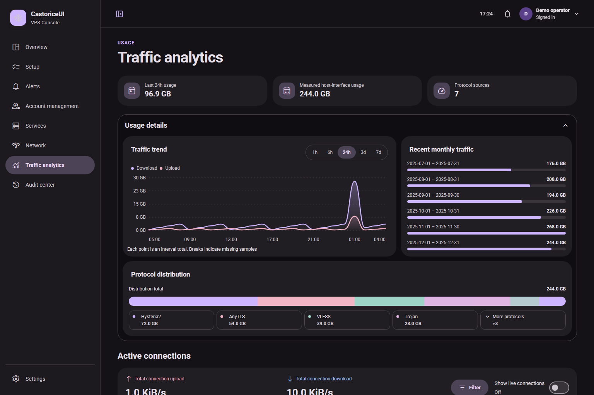

# CastoriceUI


CastoriceUI 是面向 Linux VPS 的 Material Design 3 可观测控制台，用于集中查看主机资源、真实网卡流量、代理连接、网络质量、服务状态、订阅记录、告警与审计信息。

项目由 React 前端和轻量 Python/SQLite 后端组成。后端仅需接入本机数据源，浏览器不会直接访问协议管理接口，也不会用模拟数据替代不可用的生产数据。

[v6.6.0 安装包](https://github.com/Kokomi-maomeng/Material-Design-CastoriceUI/releases/download/v6.6.0/CastoriceUI-v6.6.0.tar.gz) · [SHA-256 校验文件](https://github.com/Kokomi-maomeng/Material-Design-CastoriceUI/releases/download/v6.6.0/SHA256SUMS.txt) · [快速部署](docs/DEPLOYMENT.md#choose-the-route) · [支持矩阵](docs/SUPPORT_MATRIX.md)



## 功能范围

- Linux 主机 CPU、内存、存储、负载、运行时间及网卡计数器；服务状态提供近 1、6、24 小时 CPU 与内存采样曲线
- 1 小时至 7 天的自适应流量趋势、跨重启统一增量账本、默认关闭或按日/周/月/年自定义的额度重置周期
- 流量分析集中显示趋势、近期月流量、协议占比与实时连接，连接字段以协议核心实际输出为准
- 账号管理显示账号状态、累计流量和关联订阅，未匹配账号的 HY2 核心累计固定在列表首行
- IPv4/IPv6 网络质量探测、服务健康、告警确认及审计中心
- 首次安全初始化、应用登录、真实密码更换、会话与 CSRF 防护、界面与面板设置
- 响应式桌面与移动端布局、浅色/深色主题及减少动态效果支持

## 协议接入

| 数据源 | 当前支持 |
| --- | --- |
| Hysteria2 | Traffic Stats API 的累计流量、在线计数与活动流 |
| sing-box | AnyTLS、VLESS、XTLS Vision、Reality、SOCKS5、Shadowsocks、VMess、Trojan、TUIC |

## 本地开发

需要 Node.js `^20.19.0 || ^22.12.0 || >=24.0.0`（本轮受测 LTS：24.22.1） 与 Python 3.11+：

```bash
git clone https://github.com/Kokomi-maomeng/Material-Design-CastoriceUI.git
cd Material-Design-CastoriceUI
npm ci
npm run doctor
python3 -m venv ../.castoriceui-venv
node scripts/python-run.mjs -m pip install -r server/requirements.txt
npm run check
npm run dev
```

Debian 源码环境先安装 `python3-venv`。Windows PowerShell 将创建环境那一行改为 `python -m venv ../.castoriceui-venv`；其余命令相同。检查脚本自动优先使用项目 `../.castoriceui-venv`，无需修改系统 PATH 或执行激活脚本。Windows 的 IANA 时区数据随 requirements 安装。功能依赖与已验证环境见 [`支持矩阵`](docs/SUPPORT_MATRIX.md)。

`npm run dev` 会在 `https://127.0.0.1:5173` 启动仅监听回环地址的开发服务器，使用本地生成的开发证书，并把 `/api/` 代理到 `http://127.0.0.1:18080`。首次访问需在浏览器确认本地证书。后端必须另行运行在 Linux/WSL，或通过 SSH 端口转发到本机回环端口；代理目标只能通过 `CASTORICEUI_DEV_API_TARGET` 设置为 HTTP 回环 URL。Secure Cookie 不会被关闭。后端不可用或采集失败时，页面会显示明确错误且不生成演示流量。完整接口约定见 [`docs/INTEGRATION.md`](docs/INTEGRATION.md)。

运行浏览器回归或查看回环合成示例，见 [贡献指南](CONTRIBUTING.md)。Windows 默认以两个 worker 运行 Vitest。必要时可用 PowerShell 执行 `$env:VITEST_MAX_WORKERS='1'; npm run check` 复查负载导致的超时，检查范围相同。

## 生产部署

- 空白 Debian：准备主机、TLS 站点、安装包和引导码。见 [部署步骤](docs/DEPLOYMENT.md#choose-the-route)。
- 已有代理主机：沿用同一安装路径，在受保护配置中登记现有回环接口。见 [数据接入](docs/INTEGRATION.md)。
- 面板升级：先检查当前版本权限和 SQLite 回退点。见 [安装或升级](docs/DEPLOYMENT.md#5-install-or-upgrade)。

生产环境建议使用 systemd、Nginx 与有效 TLS。CastoriceUI 后端、Hysteria2 Traffic Stats API 和 sing-box Clash API 均应只监听回环地址，由 Nginx 同源提供网页与 `/api/`。

部署与升级步骤见 [`docs/DEPLOYMENT.md`](docs/DEPLOYMENT.md)。升级前应备份受保护配置、完整的 `state.db*`、当前前后端目录、systemd 单元和 Nginx 站点，并保留可验证的回滚版本。

首次初始化向导可完成节点、额度、探测目标和已运行协议的接入验证。代理核心、API Secret、管理账号和订阅记录需要先在服务器受保护配置中准备；向导不会自动创建它们。CPU、内存和流量历史图只显示部署后实际积累的采样。

安全边界及漏洞报告方式见 [`SECURITY.md`](SECURITY.md)，贡献要求见 [`CONTRIBUTING.md`](CONTRIBUTING.md)，本次发布说明见 [`docs/RELEASE_NOTES_v6.6.0.md`](docs/RELEASE_NOTES_v6.6.0.md)，背景和设置说明见 [`docs/V5.3_BACKGROUND.md`](docs/V5.3_BACKGROUND.md)。

浏览器最低版本与发布验证边界见 [`docs/BROWSER_SUPPORT.md`](docs/BROWSER_SUPPORT.md)。

## English

CastoriceUI is a Material Design 3 observability console for Linux VPS hosts. It combines host metrics, real interface traffic, proxy connections, network quality, service health, subscriptions, alerts, and audit records in a responsive interface.

The React frontend uses a lightweight Python/SQLite backend. Hysteria2 is integrated through its Traffic Stats API. sing-box connections are classified only through explicit inbound-tag mappings for AnyTLS, VLESS/XTLS/Reality, SOCKS5, Shadowsocks, VMess, Trojan, and TUIC.

For local development, run `npm ci`, `npm run check`, and `npm run dev`. Vite listens only on `https://127.0.0.1:5173`, creates a local development certificate, and proxies `/api/` to `http://127.0.0.1:18080`. Run the backend separately on Linux/WSL or expose a remote loopback backend through an SSH local port forward. `CASTORICEUI_DEV_API_TARGET` accepts HTTP loopback URLs only, and Secure cookies remain enabled. Keep every production backend or protocol-management endpoint on loopback behind Nginx and valid TLS.

For a **new Debian panel**, follow the [host and TLS setup](docs/DEPLOYMENT.md#choose-the-route). For an **existing proxy host**, add its loopback API settings in the protected config. For an **upgrade**, use the [transactional installer](docs/DEPLOYMENT.md#5-install-or-upgrade) after verifying the current release and rollback point.

## License

[MIT](LICENSE)
